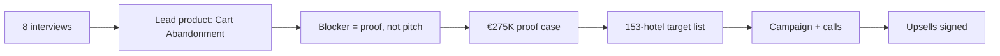
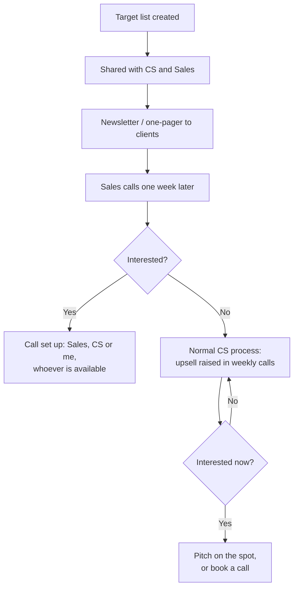

# Building an upsell motion from zero

**Namastay · 2026 · Owner, end to end**

## The problem

Namastay had ~273 live hotels and several paid features most of them weren't using. There was no upsell process: no agreed lead product, no target list, no materials. I was asked to pick which features to sell into the existing base and build a motion that could be repeated.

## What I did

**1. Asked the people who'd have to sell it.** I ran 15-minute one-on-ones with all eight sales and customer-success colleagues. Same questions each time: which feature is easiest to sell, what objection kills it, and what would make you pitch it tomorrow.

**2. Picked the lead product from the answers.** Cart Abandonment (automated emails to guests who start a booking and drop off) won with 7 of 8 votes. It was the easiest sell, needed little CS work after setup, and a free trial removed the price objection.

**3. Found the actual blocker.** Every interview said the same thing in different words: the pitch was fine, but there was no proof it worked. So I built the proof case from live data across existing clients:

| Recovery emails sent | Bookings recovered | Conversion | Revenue recovered | Avg recovered booking |
|---|---|---|---|---|
| 2,285 | 200 | 8.75% | **€274,998** | €1,375 |

**4. Built the targeting data.** For each hotel I pulled a "% not starting payment" figure from Mixpanel (May–July 2026), matched the CRM against the booking database (294 hotels), and built two outreach lists (French: 50; mixed: 145), split into 159 + 328 contacts with language, country and go-live date.

**5. Built the target list.** I merged two messy exports (recently-contacted people and the master customer list) into **153 hotels** with go-live dates, countries and up to 10 contacts each. Cleaning it meant fixing an email-security bounce prefix, a company field stored as a raw domain, multi-email cells with no separator, and dates parsed day-month the wrong way round.

**6. Built the assets.** A 13-week roadmap, a one-pager in English and French, outbound emails with per-hotel merge fields (guest count, drop-off %), follow-up variants, a phone script, and a progress update for the team.

**7. Sequenced the rest of the portfolio.** Exclusive Rates as a free companion to Cart Abandonment; restaurant integration second (strongest client pull); enhanced multi-property third (blocked on a product gap); two features parked.

**The outreach flow I designed:**

## Decisions that mattered

- **Low-lift channels over CS-led selling.** Interviews showed CS bandwidth was the binding constraint: they were too busy implementing new hotels to upsell. So the motion leaned on email and short calls, not account reviews.
- **Timing to budget cycles.** Hotels told CS they "take Namastay at the end of their budget," so outreach was timed toward renewal and budgeting windows rather than sent all at once.
- **A reusable targeting table, not a one-off list.** Every interviewee raised the same gap: there was no way to tell which hotels were eligible. I proposed a scored table per feature (booking system, booking volume, existing add-ons, overlap with a competing email tool, group status), built once for Cart Abandonment and reusable for every future upsell. The competing-tool overlap turned out to be the biggest eligibility cut.

## Result

- **5 hotels signed Cart Abandonment upsells, €10.8K ACV**, with one more in process.
- A repeatable upsell playbook and targeting method the team can reuse feature by feature.
- Directional Q3/Q4 2026 targets for new MRR and conversion metrics.

**Skills:** user interviews · prioritisation · data analysis · GTM · data cleaning · stakeholder management
