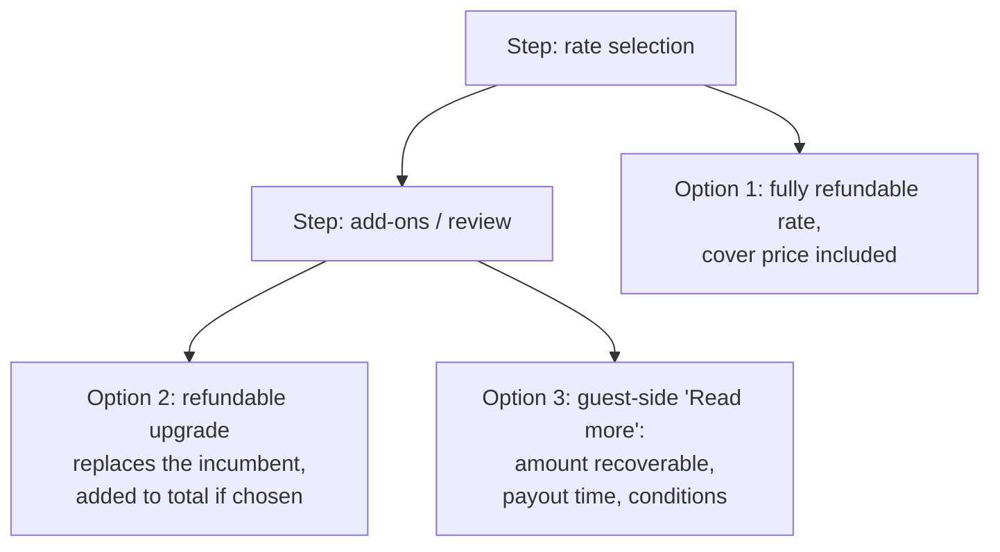
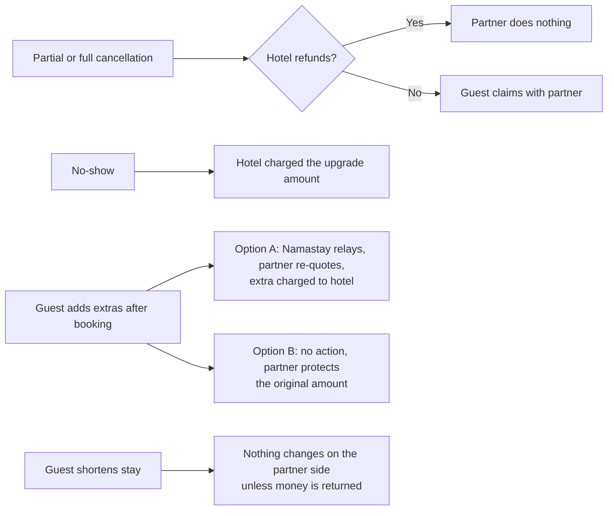
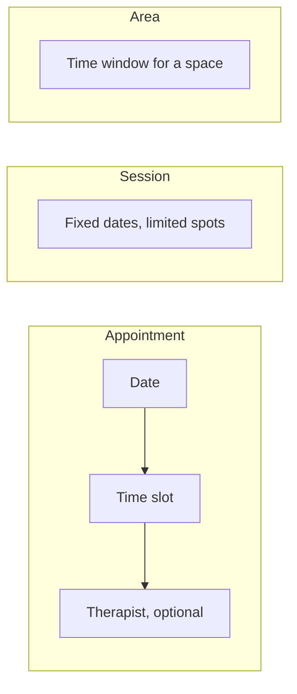

# Partnerships: what to build, what to kill

**Namastay · 2026 · Business cases, requirements and go-to-market**

Namastay grows by putting more of the guest's spend inside its booking flow. I evaluated four partnerships, each a different bet on that idea. I led two end to end, scoped a third, and recommended dropping the fourth.

| Partner type | Bet | Outcome |
|---|---|---|
| Refund protection | Ancillary revenue at checkout | Negotiated and signed; €50K integration bonus received |
| Restaurant booking | Book dinner with the room | v1 live; v2 prioritised and specced |
| Spa booking | Book treatments with the room | Decision framework, v1 scoped |
| eSIM | Sell data plans to travelling guests | **Deprioritised** |

---

## 1. Refund protection: replacing a product that barely paid

**Situation.** Namastay already offered refundable bookings through an incumbent provider. A new provider offered a better deal plus a €50K integration bonus. The question was whether switching was worth the work, and how to launch it without hurting hotel brands.

**What I found in the incumbent's data.** Guests had bought €16,106 of protection on €443,674 of bookings (3.63%), yet only **€322 reached Namastay**, because of an 8% × 25% revenue chain. Take rates varied wildly (0.07% to 8.99% by hotel), and **32% of hotels drove 84% of protected bookings**. That second number became the targeting strategy.

**What I built.**
- A business case with three take-rate scenarios (0.8% / 2.1% / 5.0%, from the median, weighted average and upper range), per-hotel revenue projections across 203 hotels, and a proposed revenue split.
- A risk analysis framed by **whose** risk it is: the guest's, the hotel's, or Namastay's.
- A **40-property launch list** across Europe, North America, LATAM and APAC, segmented by price tier, seasonality and booking behaviour. Luxury and brand-sensitive hotels excluded; one hotel per group.
- A pilot gate: at least 10 of 15 approached hotels interested before building.
- 44 requirements, three placement options in the booking flow, and cancellation, no-show and post-booking-change flows designed **before** build.
- Sales and CS training, plus an objection-handling script.

**Where it sits in the booking flow.** I mapped Namastay's 8-step booking journey and proposed three placements:

**The pilot, with a gate before any build.** A commercial track and a product track ran in parallel:

```mermaid
flowchart TD
    accTitle: Refund-protection pilot plan
    accDescr: Commercial track. First 15 hotels, 10 plus 5 backup, then demos, then a gate of at least 10 of 15 interested, then commercial agreement, enablement, go-live and the 50 thousand euro bonus. Product track in parallel. UX prototypes, shared with the partner, draft scope, feasibility with a developer, refined with dev, tickets, sprints with daily scrum, release.
    subgraph Commercial
      C1[First 15 hotels<br/>10 + 5 backup] --> C2[Demos] --> C3{≥ 10 of 15<br/>interested?}
      C3 -->|Yes| C4[Commercial agreement] --> C5[Enablement] --> C6[Go-live] --> C7[€50K bonus]
    end
    subgraph Product
      P1[UX prototypes] --> P2[Shared with partner] --> P3[Draft scope] --> P4[Feasibility with dev] --> P5[Refine with dev] --> P6[Tickets] --> P7[Sprints, daily scrum] --> P8[Release]
    end
```

**Edge cases designed before build:**

**The positioning rule that mattered:** never call it "insurance." Hotels hear liability and claims; guests hear fine print. It's positioned as an **optional refundable upgrade** and a new revenue line, at no cost or operational effort to the hotel.

**My role:** I ran scoping, the business case, requirements and go-to-market, and led the negotiation call and the sign-off alongside leadership, who made the final decision. **The €50K integration bonus has been received.**

---

## 2. Restaurant booking: who owns what

**Situation.** Luxury hotels kept telling us guests don't book dinner when they book the room, and city hotels struggle to fill their restaurants. Namastay partnered with a leading European restaurant-booking platform.

**Key decisions.**
- **Clear ownership line:** Namastay owns the whole guest experience; the partner owns backend, availability and data. This kept the flow on-brand and the integration small.
- **Traceability first.** Before committing, I confirmed in the partner's API docs that bookings made through Namastay could be tagged by source, so the value could be proven later.
- **v2 prioritised with RICE** across five candidates (confirmation-page change, restaurant step at the end of the flow, multi-restaurant bookings, guest limits, deposit collection).
- **Cleaned the requirements.** v2 had been written on top of v1; I removed 17 duplicate rows and regrouped the rest into six functional areas so engineering had one clean spec.

**My role:** I led both v1 and v2, with my manager supporting.

**Result.** Projected ~€4.6K monthly contract value. Benchmarking across four hotels in four countries showed ~4.5% of bookings add a restaurant, up to 9.1% at the best-performing hotel. Along the way I caught bookings present in add-on tracking but missing from the main booking system, and set a single source of truth.

---

## 3. Spa booking: build the flow, rent the backend

**Situation.** Real-time spa availability is hard, and our audits showed hotels either link out to a separate spa site or ask guests to email.

**What I did.**
- A **teardown of four spa-booking platforms**, screen by screen (~16 screens for the most complete one), mapping their three booking models: appointments, fixed-date sessions, and time slots for a space.
- A **ten-factor decision framework**: embed the partner's own booking widget, or build our own front-end on their API?
- Competitive research across booking engines to check whether anyone had done this deeply.

The spa partner offers three booking types:

**Decision.** Build a custom Namastay front-end with the partner as a pure backend, and scope **v1 to appointments only**, the model the partner itself recommended and the simplest to get right.

**Caveat I'd raise myself:** one hotel-booking suite already offers spa + room in one checkout, but it's a spa-and-retail module, not a booking engine with a deep spa integration. The differentiation claim depends on that distinction.

---

## 4. eSIM: the one I recommended killing

**Situation.** An eSIM provider wanted hotel distribution through Namastay.

**What the numbers said.** I modelled a case study on hotel groups of 5+ properties with €9.99/€12.99 plans, up to 20% revenue share, and 5/7/10% guest-adoption scenarios. Direct revenue stayed small in every scenario. More importantly, the provider's **proven distribution was airlines and travel agencies, not hotels**: nothing in their track record suggested hotel guests buy at booking time.

**Recommendation.** Deprioritise. If a conversation continued, frame it as their API powering an embedded eSIM step, not as Namastay introducing them to hotels.

**Why it's in the portfolio:** the cheapest partnership is the one you stop early.

---

**Skills:** business cases · scenario modelling · requirements · RICE · GTM · competitive teardown · go/no-go decisions
