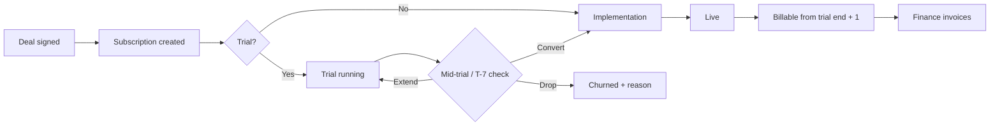
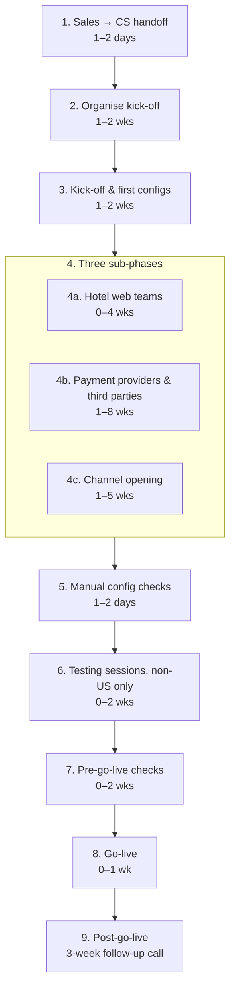
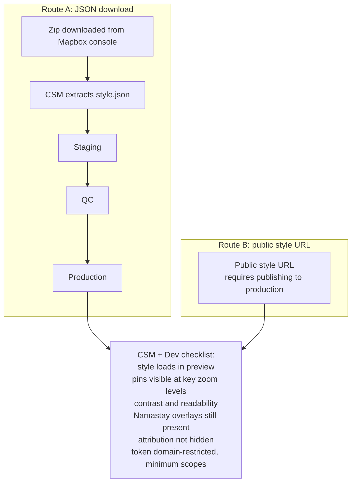

# Mapping sales-to-billing and onboarding

**Namastay · 2026 · Process design across sales, customer success, engineering and finance**

## 1. Sales to billing: the process nobody had written down

**Situation.** A signed deal passed from sales to customer success to finance with no documented process. Invoices were raised manually from a Slack channel, trials had no fixed length, and the CRM tracked hotels, not what each hotel was paying for.

**The structural insight.** The thing that flows through the process isn't the hotel. It's the **subscription**: one contract line for one product. A single hotel can hold several paid products at different stages: one live and billing, one on trial, one blocked. Tracking the hotel hides all of that.

**What I designed.**
- **Map A:** the one-time journey from signature to billable, covering both new clients and upsells.
- A new CRM **Subscription object**: product, new client vs upsell, status, trial end, billable-from date, billing model, churn reason, CS owner. Money fields moved off the company record onto the subscription.
- **"Blocked" as a flag, not a status**, so a stalled subscription doesn't vanish from pipeline reporting.
- A **trial resolution sub-flow** (convert / extend / drop) with automatic mid-trial and 7-days-before tasks, since CS set trial lengths by hand.
- A billing rule: conversions bill from **trial end + 1 day**, not from go-live.

**Still open:** Map B, the recurring monthly billing cycle, isn't built yet.

---

## 2. Onboarding: signed hotel to live hotel

**Situation.** Getting a signed hotel live took **10 weeks on average** (best 3.5, worst 18). Sales, CS and engineering each saw their own part; nobody saw the whole.

**What I did.** Mapped the journey into **9 phases**, each with a time range and exit criteria, reviewed with two senior colleagues including my manager. Then I pulled real cases to locate where time actually went:

| Pain point | Evidence |
|---|---|
| Information asked twice | Payment credentials arrived ~1 week after kick-off; website contact ~12 days after |
| Slow hand-offs | 3–5 day gaps between sales hand-off and CS pickup |
| Kick-off lag | One hotel's kick-off came ~11 days after hand-off; website access took ~3 weeks |
| Payment-provider setup | One provider took ~4 weeks to issue a new credential |
| Booking-system gaps | Rate-visibility gaps on one system, missing add-on prices on another, mismatched room IDs on a third |
| Final bottleneck | Opening booking channels was consistently the last thing blocking go-live |

The nine phases, with the time range each one takes:

**Future state: 16 proposed automations**, each tied to evidence and marked by whether it needs engineering. Examples: block a deal from closing without hand-off fields; auto-create a hand-off thread and task pack; record the kick-off and extract answers into the CRM; chase channel opening after 5 days; phase timers with a Monday digest.

---

## 3. Taking hotels live

The company KPI sheet attributes **€41.6K of live ACV** to my work:

| What went live | ACV |
|---|---|
| A hybrid-hotel brand's two-hotel launch, Paris and Vienna | €17,280 (€7,848 + €9,432) |
| A Mediterranean island resort | €4,860 |
| Four hotels in one UK hotel collection | €8,640 (€2,160 each) |
| Five Cart Abandonment upsells ([upsell programme](01-upsell-programme.md)) | €10,800 |
| **Total live** | **€41,580** |

That's **seven hotels taken live** plus five upsells. Five more hotels from the same resort group as the island resort are in process (€4,860 each).

For the Paris and Vienna launch I was the primary contact while my manager was away: daily updates, an issue tracker kept current, prioritised bug tickets and a live-testing log. I ran the booking-engine integration test suite of **195 cases**: passes went from **42 to 77** and failures from **14 to 7** over June–July, with issues, bugs and feature requests logged for engineering. One request, a marketing opt-in, shipped as a product change. Both properties went live in August 2026.

---

## 4. Small tools and documents that saved time

- **Live client map** for sales: diffed a new CRM export against the hard-coded hotel list, added 18 newly live properties and removed a duplicate, bringing it to **250+** hotels with a self-updating count. [Demo on synthetic data](https://arko1911.github.io/Arkoprava-Pal/hotel-map.html).
- **Contract to CRM:** extracted properties, room counts, legal entity, terms, contacts and notice periods from a signed contract into a colour-coded CRM import, flagging fields the contract didn't actually evidence.
- **Deeplink builder** covering SynXis (217), D-Edge (84) and Mews (18).
- **CRM-to-database hotel mapping** across 294 hotels.
- **January bug report by source system**, each issue tied to a Jira ticket.
- **Payment-link competitor matrix:** about 15 vendors compared across 15 capabilities.
- **Enhanced Multiproperty requirements** (map-provider criteria and a v2.1 destination search), with a **Mapbox Studio feasibility report**.
- **Custom map styling for hotel groups:** two hand-off routes for a group's own Mapbox style, plus a validation checklist for customer success and dev:

**Skills:** process mapping · data modelling · cross-functional alignment · root-cause analysis · implementation management
