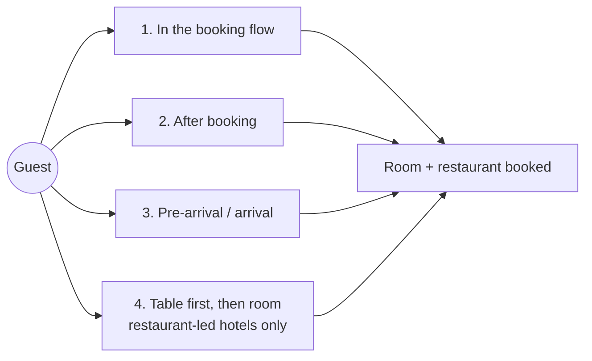
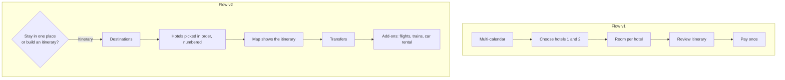
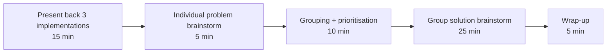

# Discovery: experiences, not just rooms

**Namastay · 2026 · Research I ran; my manager and the product designer reviewed and commented**

## 1. "Guests book a stay, engines sell a room"

**The hypothesis.** Luxury hotels sell an experience (dinner, spa, a hike, a cooking class) but every booking engine, ours included, treats the **room** as the product. If guests could book the whole stay in one place, hotels would sell more and guests would book earlier.

**How I tested it.** Two tracks in parallel: broad problem-finding, and concrete opportunities (restaurant and spa integrations, pre-arrival emails, multi-hotel journeys, wellness packages).

I used market segmentation, a review of existing customers, a customer reference group, problem gathering and an **opportunity–solution tree**. A **19 March brainstorm** mapped guest and hotel problems on a less-to-more impact axis, from a 15-minute phone call to book a massage, to too many tools, to no full guest view in the CRM, to converting traffic.

- **Market map** of experience platforms by category: restaurants (OpenTable, TheFork, SevenRooms, ResDiary…), spa (Book4Time, Mindbody, Vagaro…), tours (Rezdy, FareHarbor). Segments: spa, dining, journey, adventure, wellness, resorts, city, chains.
- **Portfolio scan:** of our hotels, only **55% surfaced dining** and **32% surfaced spa** booking anywhere on their site.
- **Client interviews** across several luxury properties. Recurring themes: guests don't book experiences with the room; city hotels struggle to fill restaurants; in-stay, last-minute bookings are hard; packages aren't visible.
- **A 12-property audit** of one French countryside collection: dining was bookable at 10 of 12 (via one platform), spa at 7 through a third-party tool, by email at 2, and not at all at 3. One property had nothing bookable. Friction everywhere: forced account creation, "Book" buttons opening the wrong engine, repeated language prompts.
- **Length-of-stay data** across 313,494 bookings: 40% one night, 27% two, 17% three, 8% four. **~92% of stays are four nights or fewer**, which shapes how much a guest can plausibly add.

**Six problems that came out of it:** the full experience can't be booked in one place; engines treat the room as the product; real-time spa availability is hard; upsells are missed; packages and gift cards are poorly supported; in-stay bookings are disconnected.

**Journeys I designed for room + restaurant.** Four entry points: in the booking flow, after booking, pre-arrival, and **table-first, then room** (for restaurant-led hotels). Two principles: don't force the room into a basket the guest has to manage, and use the reverse flow only where the restaurant is the draw.

This research fed the restaurant v2 and spa scoping in [Partnerships](02-partnerships.md).

---

## 2. Multi-hotel itineraries

Hotel groups with several properties (and travellers who move between them) have no way to book a route in one go.

- **Five personas:** brand-loyal explorer, premium traveller, long-stay multi-location, activity-driven, low-admin; seven problems mapped against them.
- **Flow v1:** pick dates per stop → pick hotels → room per hotel → review → pay once.
- **Flow v2:** first choose "stay in one place" or "build an itinerary"; hotels picked in order and numbered (like selecting photos on a phone); a map showing the route; transfers; travel add-ons.
- Open design questions recorded rather than papered over.
- **Trend scan of 32 hotels** from a 42-brand journey dataset: restaurants and spa surfaced at 72%, a unique experience at 59%, wellness at 44%, a fixed itinerary at 38% and a customisable one at 16%.

---

## 3. A workshop that fixed payments onboarding

**Problem.** Payment setup was the most painful part of onboarding (credentials, provider support, Apple Pay on certain booking systems), and every team blamed a different step.

**What I did.** My idea and design; my manager oversaw it given the seniority in the room. A ~60-minute format: present three real implementations → everyone writes problems individually → group and vote → design solutions in groups → agree next steps.

**What came out of it.** 20 problems, with the top votes on getting payment-provider credentials, who supports which provider, credential formats, and Apple Pay on one booking system. Agreed actions:
- payment provider made a **mandatory field at setup**;
- **themed email threads** per provider, adopted immediately;
- finance and payment contacts collected at kick-off;
- one country-specific guide per provider, updated yearly with a named owner;
- an escalation path with the booking-system vendor for Apple Pay, modelled on a hotel where it had worked.

Supporting work: a matrix of **351 payment gateways** and their card / Apple Pay / Google Pay support, reconciled across two payment orchestrators.

---

## 4. Smaller research

- **Larger desktop booking widget:** survey of 27 hotel clients (15 English, 12 French). Larger 12, current 9, no preference 6. English-speaking clients favoured larger, French clients were attached to the current one. 14 agreed to follow-up calls.
- **Accessibility (US clients):** defined nine minimum screen-reader requirements and found the booking system's accessibility certificate was from 2019, covered an older WCAG version, and excluded Namastay's customisations.

**Skills:** user research · interviews · surveys · journey mapping · personas · workshop facilitation · competitive research
