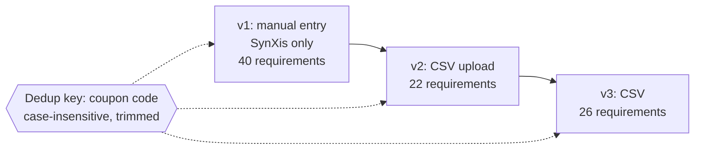

# A self-serve coupon dashboard, written as a PRD

**Namastay · 2026 · Requirements and scoping; my manager reviewed**

## The problem

Every time a hotel wanted a coupon or group code, it had to ask a customer-success manager to set it up. The aim was a self-serve dashboard so hotels could manage their own codes without a CSM in the loop.

## What I wrote

A **five-sheet requirements workbook**, each sheet laid out as Area / Requirement / Scope / Comment / Design:

| Sheet | What it specifies |
|---|---|
| Coupon Dashboard | The dashboard itself |
| CSV Upload – Templated | Upload from a template file |
| CSV Upload – Raw | Upload of a raw file, with requirements grounded in a real group-block report from a client |
| CSV Update Logic | Update rules for uploaded files |
| CSV Column Mapping | Column mapping for uploaded files |

The workbook was modelled on an existing self-serve tool in Namastay's product.

**Requirement counts:** 40 for v1, 22 for CSV v2 and 26 for CSV v3.

## Decisions that mattered

- **SynXis only for v1.**
- **Manual entry in v1, CSV upload in v2.** The CSV sheets were written up front but scoped out of the first release, so v1 could ship without CSV complexity.
- **The coupon code is the only dedup key**, compared case-insensitively and with spaces trimmed, so `SUMMER10`, `summer10` and ` Summer10 ` are one code, not three.
- **One login per hotel, not per group**, with credentials kept separate from the existing self-serve tool.

## Result

- v1 scoped so it could ship without CSV complexity, with v2 and v3 already specified behind it.
- Build status isn't recorded, so this page covers the PRD, not a launch.

**Skills:** PRD writing · scoping · data modelling · requirements · release planning
